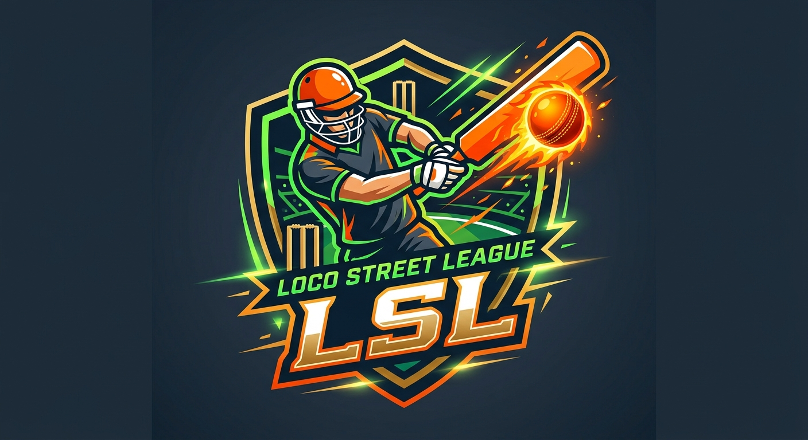
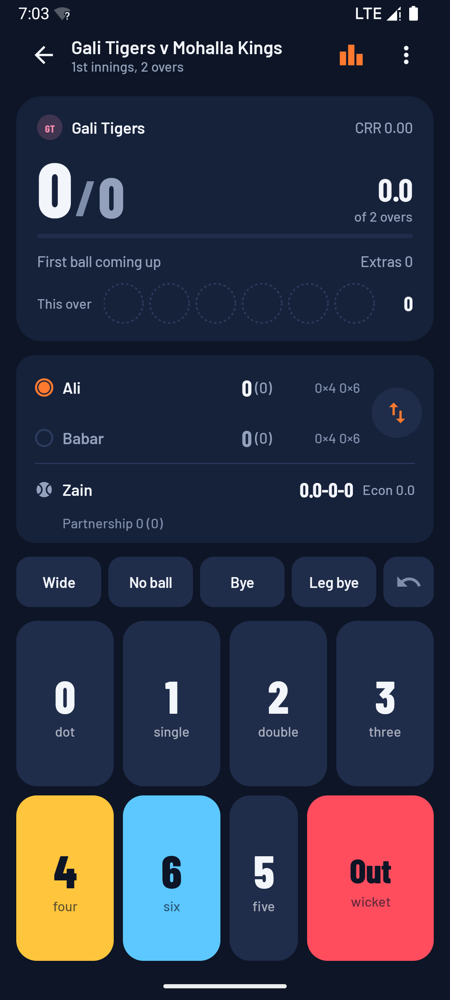
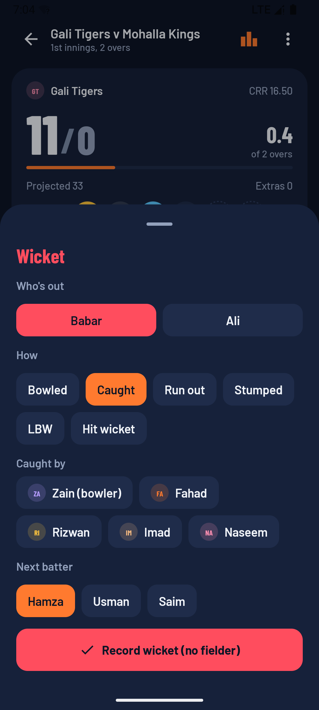
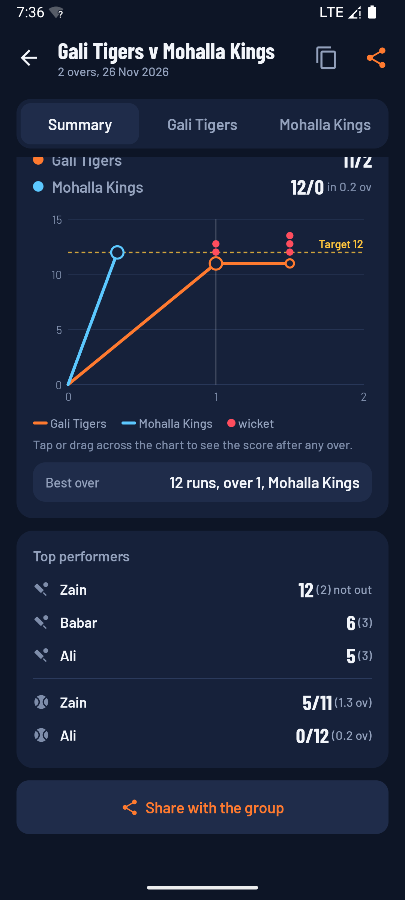
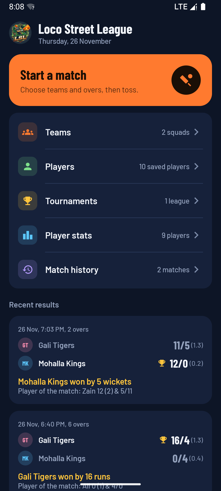
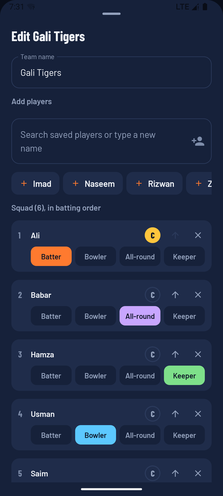
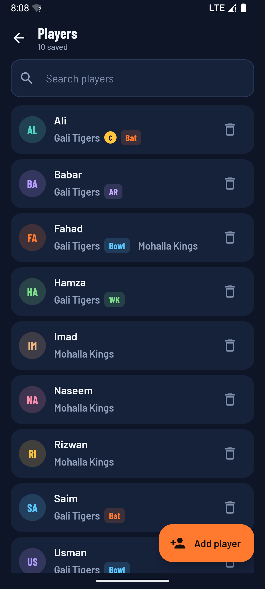

<div align="center">



# Loco Street League

Ball-by-ball scoring for street and gully cricket, built for one-handed use at the side of the pitch.

[](https://github.com/Hanan786-coder/LSL-v2/actions/workflows/build-apk.yml)
[](https://github.com/Hanan786-coder/LSL-v2/releases/latest)

</div>

## Download

Get the latest APK from **[Releases](https://github.com/Hanan786-coder/LSL-v2/releases/latest)** (under *Assets*), copy it to your phone and open it. Android asks once to allow installs from that app.

To update, install the new APK over the old one. **Do not uninstall first**: uninstalling deletes your teams, matches and stats.

Requires Android 7.0 (API 24) or newer.

## Screenshots

| Scoring | Wicket | Scorecard |
|:---:|:---:|:---:|
|  |  |  |
| **Home** | **Squad editor** | **Players** |
|  |  |  |

## Features

**Scoring**
- Everything needed for a ball fits on one screen: score, overs, run rate, the over so far, both batters, the bowler and the keypad.
- Wides, no balls, byes and leg byes; runs completed on a run out.
- Wickets record how the batter was out and who took the catch, run out or stumping.
- Strike rotates on odd runs and at the end of each over. Undo the last ball, or correct any earlier one.
- Chase line (runs needed, balls left, required rate) in the second innings; projected score in the first.
- The screen stays awake while scoring. Fours, sixes, wickets, 50s and 100s get a short animation and vibration.

**Gully rules**
- An innings ends only when every batter is out. The last batter can carry on alone and keeps the strike.
- End an innings early (bad light, lost ball) from the menu.

**Teams and players**
- Saved players can join several teams, with a different role in each: batter, bowler, all-rounder or keeper.
- One captain per team, shown as (c) on the scorecard; keepers as (wk).
- Batting order follows the squad order.

**After the match**
- Full scorecard for both innings, with dismissals such as *c Fahad b Zain*.
- Run race chart: both innings' running totals over by over, with the target and wickets. Drag across it to read the score after any over.
- Share the summary to WhatsApp or any app.

**Records**
- Match history grouped by month, with search.
- Career stats for batting (runs, strike rate, fours, sixes), bowling (wickets, economy) and fielding (catches, run outs, stumpings).
- Tournaments with a points table (2 for a win, 1 for a tie, net run rate) and recent form, plus round-robin fixtures.

## Your data

All data lives on the phone in a local database. Nothing is uploaded.

Updates keep existing data:
- Database changes ship with migrations. The app never wipes its database on a schema change.
- Ball-by-ball logs from older versions are read and corrected on load. For example, no balls and wides that older versions counted twice are fixed automatically.

## Build from source

**Requirements:** JDK 17 or newer (Android Studio's bundled JDK works) and the Android SDK with platform 36.1.

```bash
git clone https://github.com/Hanan786-coder/LSL-v2.git
cd LSL-v2
./gradlew :app:assembleDebug        # Windows: gradlew.bat :app:assembleDebug
```

The APK is written to `app/build/outputs/apk/debug/app-debug.apk`.

Debug builds are signed with `debug.keystore` in the project root. It is not committed. Create one if it is missing:

```bash
keytool -genkeypair -keystore debug.keystore -storepass android -alias androiddebugkey \
  -keypass android -keyalg RSA -keysize 2048 -validity 10000 -dname "CN=Android Debug,O=Android,C=US"
```

Keep that file. An update installs over an existing copy of the app only when both are signed with the same key.

Run the scoring tests:

```bash
./gradlew :app:testDebugUnitTest --tests "com.example.data.CricketScorerTest"
```

## Releases

[`.github/workflows/build-apk.yml`](.github/workflows/build-apk.yml) builds and tests the app on every push to `main`. The APK is attached to the workflow run as an artifact.

To publish a release with the APK under *Assets*:

1. Raise `versionCode` and `versionName` in `app/build.gradle.kts`.
2. Tag the commit and push the tag:

   ```bash
   git tag v1.2.0
   git push origin v1.2.0
   ```

**Signing in CI.** Save the project's `debug.keystore` as a repository secret named `SIGNING_KEYSTORE_BASE64`, so released APKs can update the copy already on your phone. Add it under *Settings → Secrets and variables → Actions*, or with the GitHub CLI:

```powershell
[Convert]::ToBase64String([IO.File]::ReadAllBytes("debug.keystore")) | gh secret set SIGNING_KEYSTORE_BASE64
```

Without the secret, CI signs with a temporary key and marks the run with a warning. That APK installs fresh but cannot update an existing install.

## Tech stack

- Kotlin and Jetpack Compose (Material 3)
- Room for local storage, Moshi for the ball-by-ball log
- MVVM with a single `LocoViewModel` and `StateFlow`
- Barlow and Barlow Condensed (SIL Open Font License), bundled in `res/font`

## Project structure

```
app/src/main/java/com/example/
├── MainActivity.kt              Navigation and screen transitions
├── data/
│   ├── Entities.kt              Room entities: teams, players, squads, matches, stats
│   ├── LocoDatabase.kt          Database and migrations
│   ├── LocoDao.kt               Queries
│   ├── MatchRepository.kt       Squad saving, career stats
│   └── CricketScorer.kt         Scorecards, overs, partnerships from the ball log
└── ui/
    ├── LocoViewModel.kt         Match rules: strike, wickets, innings, results
    ├── ScoringScreen.kt         Live scoring pad and sheets
    ├── ScorecardScreen.kt       Scorecard, sharing
    ├── RunRaceChart.kt          Run race chart
    ├── TeamsManageScreen.kt     Squads, roles, captain
    ├── PlayersScreen.kt         Saved players
    ├── TournamentScreen.kt      Leagues, points table, fixtures
    ├── LeaderboardScreen.kt     Career stats
    ├── HistoryScreen.kt         Match history
    ├── LslComponents.kt         Shared UI components
    └── theme/                   Colours, type, shapes
```
